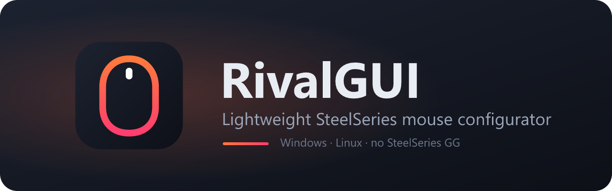

<p align="center">
  
</p>

<p align="center">
  <a href="https://github.com/Advve/rivalgui/actions/workflows/build.yml"></a>
  <a href="https://github.com/Advve/rivalgui/blob/main/package.json"></a>
  <a href="LICENSE"></a>
  
  <br>
  
  
  
  
</p>


A light, native configurator for SteelSeries mice on **Windows** and **Linux**, without SteelSeries GG.
It is built on the device support of [rivalcfg](https://github.com/flozz/rivalcfg) (76 models:
Rival, Sensei, Aerox, Prime, Kana, Kinzu), currently in sync with rivalcfg **4.17.0**.

> **Disclaimer:** RivalGUI is an independent project. It is not affiliated with, endorsed by
> or sponsored by SteelSeries. SteelSeries, Rival, Aerox, Prime, Sensei, Kana and Kinzu are
> trademarks of SteelSeries ApS, used here only to describe the supported hardware.

- **Auto-detection.** Mice are picked up a couple of seconds after you plug them in.
- **Every setting rivalcfg supports.** DPI presets (with separate X/Y DPI on the Rival 3 Gen 2
  family), polling rate, LED colors, gradients,
  reactive colors, button remapping (mouse, media and keyboard keys), sleep/dim timers.
- **Profiles.** Keep named setting profiles per mouse (Gaming, Work, ...) and switch them
  from the window or the tray menu.
- **Tray background service:**
  - re-applies your settings when a mouse is plugged in or wakes up (handy for mice without
    onboard memory)
  - shows the battery level of wireless mice in the tray icon and tooltip
  - sends a low-battery notification
  - starts with the system, if you enable it
- **English and Polish.** The language follows the system or can be chosen in Preferences
  (window, tray menu and notifications).
- **Light.** About 4 MB executable and a 1.4 MB installer. Closing the window destroys the
  webview, so in the tray only the Rust process stays resident (about 6 MB private memory).

## Install

Download the latest version from the
[Releases page](https://github.com/Advve/rivalgui/releases/latest).

- **Windows:** run `RivalGUI_x.y.z_x64-setup.exe`. It installs per-user, so no admin is needed.
  The WebView2 runtime ships with Windows 10/11.
  - **Upgrading:** run the newer installer. It detects the installed version, closes the
    tray app, uninstalls the old version and installs the new one. Settings, shortcuts and
    "start with system" are kept.
  - Reinstalling the same version, or installing an older one, shows the usual choice page.
- **Linux:** install the `.deb` or `.rpm` (they include the udev rules), or use the AppImage
  and click *Preferences → Install rules* once.
  - The tray needs AppIndicator support. GNOME users need the
    "AppIndicator and KStatusNotifierItem Support" extension.

## How it works

```
tools/export_profiles.py   rivalcfg device profiles  ->  src-tauri/resources/profiles.json (+ udev rules)
tools/gen_golden.py        rivalcfg + FakeDevice      ->  src-tauri/tests/golden.json (4943 packets)
src-tauri/src/core/        Rust port of rivalcfg: profiles, value handlers (encode/), HID I/O
src-tauri/src/service/     config store, watcher thread (hot-plug, battery, auto-apply), tray
src-tauri/src/commands.rs  IPC used by the UI
src/                       Svelte 5 UI (one control per rivalcfg value type)
```

The Rust encoders are checked **byte for byte** against rivalcfg itself. `cargo test` replays
every recorded case, including the ones that must fail.

Settings are stored in `%APPDATA%\rivalgui\config.json` on Windows and
`~/.config/rivalgui/config.json` on Linux. Values use rivalcfg's CLI syntax, e.g.
`"sensitivity": "400, 800, 1600"` or `"logo_color": "rgbgradient(duration=1000; colors=0%: red, 50%: blue)"`.

Auto-apply only sends the values you changed in RivalGUI. A mouse you configured elsewhere is not
reset when you first plug it in. Switching or re-applying a profile sends the full profile,
with factory defaults for anything you never changed.

## Develop

Requirements:
- Node 20+
- Rust stable
- Windows: the MSVC C++ build tools
- Linux: `libwebkit2gtk-4.1-dev libayatana-appindicator3-dev librsvg2-dev libudev-dev`

```bash
npm install
npm run tauri dev          # run the app
cargo test --manifest-path src-tauri/Cargo.toml   # golden tests
npx tauri build            # installers in src-tauri/target/release/bundle
```

Simulation mode without hardware:

```bash
RIVALGUI_DRY=1 npm run tauri dev                   # fake Aerox 3 Wireless, Rival 3, Rival 600
RIVALGUI_DRY=1038:1702,1038:1720 npm run tauri dev # pick the devices (vid:pid)
```

Packets are printed to stderr instead of being sent. `RIVALGUI_CONFIG_DIR` overrides the config
location.

The installer uses a customized copy of Tauri's NSIS template
(`src-tauri/windows/installer.nsi`; search it for "RivalGUI"). Its artwork is generated by
`npm run art`. After upgrading `@tauri-apps/cli`, re-apply that small patch to the
matching upstream template with `npm run installer:template -- <upstream installer.nsi>
src-tauri/windows/installer.nsi`.

Updating device support from a newer rivalcfg (the only step that needs Python, because it runs
rivalcfg itself; the app and its build only need Node and Rust): extract it next to this project or in
`~/Downloads` (the newest `rivalcfg-X.Y.Z` folder is picked up automatically, or set
`RIVALCFG_SRC`), then:

```bash
python tools/export_profiles.py
python tools/gen_golden.py
cargo test --manifest-path src-tauri/Cargo.toml
```

If a new rivalcfg release adds a value type (handler), the golden test fails with
`Unknown handler`. Port it to `src-tauri/src/core/encode/` and map it to a UI kind in
`src-tauri/src/core/view.rs`.

## Releasing

1. Set the new version in `package.json`, `src-tauri/tauri.conf.json` and `src-tauri/Cargo.toml`.
2. Add a `- **X.Y.Z** ...` entry at the top of the changelog below. It becomes the release notes.
3. Commit, then tag and push:

   ```bash
   git tag vX.Y.Z
   git push origin vX.Y.Z
   ```

CI builds everything, checks that the tag matches all three versions and has a changelog entry,
then publishes a GitHub Release with the installers and `SHA256SUMS.txt`.
`node tools/release-notes.mjs --check X.Y.Z` runs the same check locally.

## Changelog

- **1.0.0** (first release), with rivalcfg 4.17.0 device support (76 models)
  - Auto-detection, live settings, named profiles, tray service (auto-apply, battery,
    low-battery notification, autostart)
  - Every rivalcfg value type, including separate X/Y DPI presets
    (Rival 3 Gen 2 / Rival 3 Wireless Gen 2)
  - English and Polish interface, selectable in Preferences
  - Windows installer that upgrades older versions in place: the previous version is
    uninstalled automatically and settings are kept

## License

RivalGUI is released under the [MIT License](LICENSE). Copyright (c) 2026 Adve.

Device support is based on [rivalcfg](https://github.com/flozz/rivalcfg) by Fabien Loison
and contributors (WTFPL). The installer uses a modified copy of
[Tauri](https://github.com/tauri-apps/tauri)'s NSIS template (MIT).

The licenses of all bundled third-party components are in
[THIRD-PARTY-NOTICES.txt](THIRD-PARTY-NOTICES.txt), which is also installed next to the app.
Regenerate it after changing dependencies:

```bash
npm run notices
```
